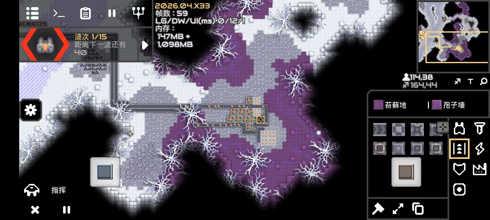

# MobileJoystickControl
<h1 align="center">
  <a href="https://github.com/DeterMination-Wind/MobileJoystickControl/releases/latest"></a>
  <a href="https://github.com/DeterMination-Wind/MobileJoystickControl/releases"></a>
  <a href="LICENSE"></a>
  <a href="https://github.com/DeterMination-Wind/MobileJoystickControl"></a>
</h1>

> [!NOTE]
> 若有反馈，请发送反馈到bugsoc@qq.com / If you have any feedback, please send it to bugsoc@qq.com

`移动摇杆操控 / Mobile Joystick Control`

A Mindustry Java client mod that provides Minecraft PE style on-screen controls for player units on mobile:

- Left stick movement with analog speed scaling.
- Boost toggle button.
- Two shooting schemes:
  - Dual-stick shooting (right stick aim + fire).
  - Single-stick + fire button.
- In-game layout edit mode (drag controls on HUD).
- Position and size sliders for every control in settings.
- v1.1.0:
  - Desktop debug mode (`JoystickDesktopInput`) for testing on PC.
  - Deadzone, HUD opacity, and aim distance sliders in settings.
  - Size slider in layout edit mode (resize selected control on the fly).

## Build

Desktop test jar:

```powershell
cd MobileJoystickControl
gradle build
```

Artifact:

- `build/libs/MobileJoystickControlDesktop.jar`
